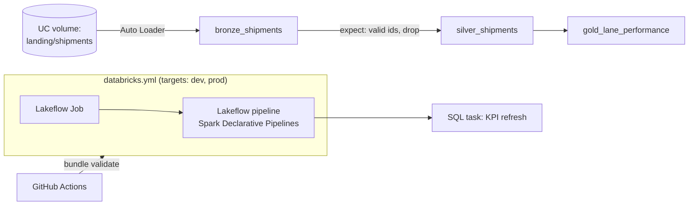

# databricks-lakeflow-bundle

[](https://github.com/navyaajs-web/databricks-lakeflow-bundle/actions/workflows/ci.yml)


A Databricks Asset Bundle that deploys a Lakeflow Spark Declarative Pipeline. Databricks now calls these bundles Declarative Automation Bundles. Its features:
- Expectations for data quality.
- Unity Catalog three-level names (`catalog.schema.table`).
- Separate `dev` and `prod` targets.
- A Lakeflow Job that runs the pipeline and a downstream SQL task.

**Portfolio build:** the Databricks features shown here (Lakeflow, Asset Bundles, Unity Catalog) were learned and built for this repository. They are not claimed as employer experience.

## Problem
Teams adopting Databricks need pipelines that can be:
- Version-controlled.
- Promoted from dev to prod without clicking through the UI.
- Governed through Unity Catalog.

## Architecture


## Run it in three commands (local, no workspace)
```bash
make setup     # venv + pyspark + pytest
make test      # transformations are plain functions, tested with local Spark
make validate  # databricks bundle validate (needs the Databricks CLI; skipped in CI if no host)
```
**Optional deploy:** `databricks bundle deploy -t dev`. A free Databricks workspace is enough; see `docs/deploy.md`.

## What this proves
- I know current Databricks platform practice: declarative pipelines with expectations, Unity Catalog naming, and bundle-based CI/CD with dev/prod promotion.

## Limitations
- CI cannot run the pipeline itself, because that needs a workspace. Transformation logic and expectation rules are tested locally instead. The pipeline file (`pyspark.pipelines` decorators) is checked statically.
- Unity Catalog grants are documented, not applied.

## About the author
Built by Navya Sindhu, Senior Data Engineer. [LinkedIn](https://www.linkedin.com/in/navyaajs/). This is a personal project with synthetic data.
